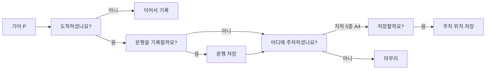

# Route94

**주차하는 순간, 차가 묻고 운전자는 대답만 합니다.** 운행 기록과 주차 위치, 인상 깊었던 장소를 남기고 휴대폰에서 다시 볼 수 있는 Pleos Connect 전용 주행 기록 앱입니다.

현대자동차그룹 **차량용 앱 개발 공모전 — Code your App into Pleos App Market** 출품작입니다. 팀 **개척자들**. 이름은 미국 횡단 도로 Route 66에서 따왔습니다. 길 위의 모든 도착을 기록하는 앱이라는 뜻입니다.

| 항목 | 내용 |
|---|---|
| 앱 이름 | Route94 (패키지 `ai.pleos.challenge.arrival`) |
| 팀명 | 개척자들 |
| 한 줄 소개 | 주차하는 순간 차량이 계기판 거리·내비 주소·위치를 스스로 기록하고 음성으로 먼저 물어, 운전자는 대답 한마디로 운행 기록·주차 위치·발자취를 남기는 주행 기록 앱 |
| 실행 방법 | [아래 실행 방법](#실행-방법) |
| 개발 에뮬레이터 | Pleos Connect v2.1.0 (Android 14, API 34), 화면 2560 × 1440 px · 160 dpi (가로) |
| 테스트 환경 | [아래 테스트 환경](#테스트-환경) |
| 필요한 설정 | [아래 필요한 설정](#필요한-설정) |
| APK | [아래 APK](#apk) |

## 이런 문제를 풉니다

운전은 결국 주차로 끝나는데, 기록할 것이 생기는 때도 바로 그 순간입니다. 운전 중에는 손을 쓸 수 없고, 차를 세우면 짐을 챙기느라 기록은 뒤로 밀립니다.

- **운행 기록:** 업무용 차량은 비용을 인정받으려면 주행 전후 계기판 거리와 운행 목적을 매번 적어야 하고, 그렇지 않아도 언제 어디를 얼마나 달렸는지 남기고 싶을 때가 있습니다. 실제로는 월말에 몰아 쓰다 부정확해지기 쉽습니다.
- **주차 위치:** 지하 주차장은 GPS가 안 잡혀 기둥 번호를 사진으로 찍어 두게 되고, 그 사진은 나중에 찾기 어렵습니다.
- **들른 곳:** 지나가다 들른 좋은 곳은 집에 오면 이름도 위치도 잊습니다.

## 이럴 때 씁니다

| 상황 | 운전자가 하는 일 | 앱이 하는 일 |
|---|---|---|
| 목적지 주차장에 도착 | 기어를 P로 바꾸면 "도착하셨나요?"에 "응", "어디에 주차하셨나요?"에 "지하 5층 A4" | 출발·도착 시각과 계기판 거리로 운행을 저장하고, 주차 위치를 기억 |
| 잠깐 정차 | "도착하셨나요?"에 "아니" | 운행을 끊지 않고 다음 도착까지 이어서 기록 |
| 주차 위치만 남길 때 | "운행을 기록할까요?"에 "아니", 또는 "주차 위치 기록해 줘" | 운행은 그대로 두고 주차 위치만 저장 |
| 차에서 내리기 전 | My Route 탭의 주차 위치 QR을 휴대폰으로 스캔 | 휴대폰에 주차 위치 페이지가 열려 지도 앱으로 열기·문자 보내기 |
| 특별하게 느껴진 곳 | "여기 기억해 줘" 또는 별 버튼 | 들른 곳과 머문 시간을 자동으로 모으고 발자국(별표)과 메모를 남김 |
| 운행기록부가 필요할 때 | My Story 탭의 QR을 휴대폰으로 스캔 | 운행기록부 양식을 채워서 열고, 엑셀 저장·인쇄 |

주차했을 때 오가는 말은 이 순서입니다.



운전자가 먼저 부를 필요가 없고, 대답을 안 하면 조용히 넘어갑니다. 모든 기록은 차량 안에만 있고 서버에 저장하지 않습니다.

## 기능

| 기능 | 설명 |
|---|---|
| 자동 운행 기록 | P를 벗어나고 돌아올 때마다 시각, 계기판 거리, 내비 주소, GPS 좌표를 기록합니다. 다른 앱이 떠 있어도 백그라운드 서비스가 이어 갑니다. |
| 주차하면 먼저 묻기 | 1km 이상 달리고 주차하면 말로 묻고, 대답만으로 운행 저장과 주차 위치 기록을 끝냅니다. 알림창에도 `기록하기`, `주차만 기록`, `말하기` 버튼이 들어갑니다. |
| 운행일지 | "운행일지 정리해 줘"로 언제든 정리합니다. 출퇴근, 일반 업무, 비업무 구분은 화면 버튼으로 바꿉니다. 기록 표는 제출 단위인 한 달씩 넘겨 봅니다. |
| 주차 위치 | "어디에 주차하셨나요?" 하나로 묻습니다. `지하 5층 A4`, `주차타워 3번`, `지상 주차, 정문 옆 편의점`, `지하 1층 B동 앞`처럼 말한 대로 남깁니다. "주차 위치 기록해 줘"라고 하면 운행일지 없이 주차 위치만 남깁니다. |
| 주차 위치 묻기 | 차 안에서 "주차 어디 했지?"라고 물으면 마지막 주차 위치를 말로 알려 줍니다. |
| 휴대폰으로 열기 | 모든 QR이 휴대폰 웹 페이지 <https://pleos-note.vercel.app> 로 열립니다. 운행 한 건·마지막 주차 위치는 기록 페이지(카카오맵·네이버 지도·구글 지도로 열기, 문자로 보내기, 복사), 월간 운행기록부는 양식 표(엑셀 저장), 발자취는 방문 목록·CSV. 기록은 링크 안에 담겨 서버에 저장되지 않습니다. |
| 발자취 | 오늘 이동한 경로와 들른 곳(`오늘 발자취`)을 자동으로 모으고, 특별하게 느껴진 곳은 별표(발자국)와 메모로 남깁니다. 주소로만 남은 곳은 주변 카페·음식점을 검색해 실제 가게 이름을 붙일 수 있습니다. 별표한 곳은 날이 지나도 `발자국` 목록에 남고, 나머지는 그날만 보관합니다. 자세한 내용은 [가족 경유지 기록 기능 설명](docs/FAMILY-JOURNEY.md). |
| 정차 중심 설계 | 글자 입력과 정리는 정차(P) 중에만 합니다. 주행 중에는 큰 버튼 두 개만 있는 전용 화면이 보입니다. |
| 개인정보 | 첫 실행 때 수집 항목과 용도를 안내하고 동의를 받습니다. 모든 기록은 차량 안에만 있고, 동의를 철회하면 전부 지웁니다. |

## 화면

탭 이름은 브랜드 스토리를 따라 **My Route**(메인) · **My Story**(운행일지) · **My Discovery**(발자취)입니다. My Route가 메인이고 나머지는 거기서 들어가는 화면입니다. 모든 화면이 **왼쪽 = 차에 남은 기록, 오른쪽 = 휴대폰으로 열기(QR)** 구성이고, 아래 말하기 바는 어디서나 같은 자리에 있습니다.

| 화면 | 왼쪽 | 오른쪽 휴대폰으로 열기 |
|---|---|---|
| My Route | My Story(운행일지)·My Stop(주차 위치)·My Discovery(발자취) 요약과 `기록하기` 버튼 | 마지막 주차 위치 |
| My Story | 한 달 단위 운행기록부 표 (‹ 월 ›) | 운행 기록 / 월간 운행기록부 |
| My Discovery | `오늘 발자취`(들른 곳, 경로) 또는 `발자국`(별표한 곳 전체) | 발자취 기록 / 엑셀 / 이 장소 지도 |
| ⚙ 설정 | 기본 정보(휴대폰 번호, 상호·사업자등록번호·차종·차량번호·부서·성명) | 지도 앱, 동의 내용 보기, 동의 철회 및 기록 삭제, 버전 |

## 사용한 Pleos SDK

| SDK | 버전 | 용도 |
|---|---|---|
| Vehicle | 2.3.2 | 기어 상태, 계기판 누적 거리 |
| NaviHelper | 3.0.5 | 현재 위치 주소 |
| FusedLocation | 1.1.3 | 주차 위치와 이동 경로 좌표 |
| TextToSpeech | 3.3.1 | 질문과 안내 음성 (온디바이스) |
| SpeechToText | 3.3.1 | 대답과 명령 인식 (온디바이스) |

## 실행 방법

### 준비

- Android Studio, Android SDK Platform 34, **JDK 17**
- Pleos Connect 에뮬레이터: [설치 가이드](https://document.pleos.ai/docs/connect/guide/getting-started/application-development/setup-connect-sdk-emulator)대로 AVD를 만들고 **Cold Boot**로 실행합니다. Quick Boot로 켜면 차량 데이터를 쓸 수 없습니다.

### 빌드와 설치

```sh
cd mockup
./gradlew installDebug
```

앱 목록에서 **Route94**를 열고 개인정보 수집·이용에 동의하면 시작합니다.

### 주행 흉내 내기

```sh
adb forward tcp:8088 tcp:8088
adb emu geo fix 127.1465 37.4502   # GPS를 내비 위치 근처로 (기본값은 미국)
```

브라우저에서 `http://127.0.0.1:8088`(Virtual Console)을 열어 둔 채 기어를 **D**로 바꾸고, 계기판 거리(Odometer)를 1km 이상 올린 뒤 **P**로 바꿉니다. 앱이 떠 있으면 아래에 "운행일지를 정리할까요?" 배너가, 내비가 떠 있으면 "도착하셨나요?" 음성이 나옵니다.

### 음성 데모

에뮬레이터 마이크는 무음이라, 미리 녹음한 대답을 순서대로 넣는 데모 모드가 있습니다.

```sh
adb shell am start --user 10 -n ai.pleos.challenge.arrival/.MainActivity --ez demo_audio true
```

말하기 버튼을 누르면 "운행일지 정리해 줘" → "지하 5층" → "에이 사" → "응" 순으로 진행됩니다. 다른 순서는 [개발 메모](docs/DEVELOPMENT.md)를 참고하세요.

### 테스트

```sh
cd mockup && ./gradlew testDebugUnitTest   # 단위 테스트 80개
node --test viewer/record.test.mjs viewer/journey-export.test.mjs   # 웹 페이지 테스트 13개
```

## 필요한 설정

- **권한:** 첫 실행 때 앱이 요청하는 마이크, 위치(`pleos.car.permission.FUSED_LOCATION`), 알림 권한을 허용합니다. 거부해도 앱은 동작하지만 음성·지도 링크·도착 알림이 빠집니다.
- **개인정보 동의:** 첫 화면에서 "동의하고 시작"을 눌러야 차량 신호를 읽기 시작합니다.
- **휴대폰 번호 (선택):** ⚙ 설정에 내 번호를 넣어 두면 기록 페이지의 `문자로 보내기`에 받는 사람이 자동으로 채워집니다. 차량 안과 QR 링크에만 들어갑니다.
- **운행기록부 기본 정보 (선택):** ⚙ 설정의 상호·사업자등록번호·차종·자동차등록번호·부서·성명을 채워 두면 월간 운행기록부 QR을 열었을 때 양식 위쪽이 그 값으로 채워집니다. 비워 두면 빈칸입니다.
- **서버·계정:** 필요 없습니다. 휴대폰 웹 페이지 <https://pleos-note.vercel.app> 는 정적 파일이라 기록이 서버로 가지 않습니다.
- **선택 사항:** My Discovery 탭의 주변 장소 검색은 카카오 REST API 키를 로컬 Gradle 속성 `kakaoRestApiKey`로 넣고 빌드하면 켜집니다. 키 없이도 나머지 기능은 모두 동작합니다.

## APK

| 항목 | 내용 |
|---|---|
| 파일 | [`apk/개척자들_Route94_release.apk`](apk/개척자들_Route94_release.apk) |
| 버전 | 1.0 (versionCode 1), 패키지 `ai.pleos.challenge.arrival` |
| 빌드 | release, APK Signature Scheme v2 서명. 서명 키와 카카오 API 키는 소스 코드에 포함하지 않습니다(카카오 키는 장소 검색을 위해 릴리스 APK 빌드에만 들어갑니다). |

설치: `adb install -r --user 10 apk/개척자들_Route94_release.apk` (Pleos 에뮬레이터는 사용자 10에서 앱이 실행됩니다.) 디버그 빌드가 이미 설치돼 있으면 서명이 달라 먼저 `adb uninstall ai.pleos.challenge.arrival`이 필요합니다.

직접 빌드하려면 `mockup/`에서 `./gradlew assembleRelease` (서명 정보는 로컬 Gradle 속성 `route94StoreFile` 등 4개, 없으면 서명 없는 APK가 나옵니다).

## 테스트 환경

| 항목 | 내용 |
|---|---|
| 에뮬레이터 | Pleos Connect v2.1.0 (Android 14, API 34, arm64) |
| 화면 규격 | 2560 × 1440 px, 160 dpi (가로) |
| 개발 PC | macOS (Apple Silicon), Android Studio, JDK 17 |
| 빌드 | Gradle 8.10.2, AGP 8.8.2, Kotlin 2.0.0, compileSdk 35, minSdk 28 |
| 휴대폰 | iPhone·Galaxy 기본 카메라로 차량 화면의 QR을 찍어 기록 페이지 확인 |

실제 차량에서는 아직 확인하지 못했습니다. 특히 내비가 떠 있는 동안의 마이크 입력은 에뮬레이터에서 녹음 파일로만 검증했습니다.

## 저장소 구성

```
mockup/      Route94 앱 (Kotlin, Jetpack Compose)
viewer/      휴대폰에서 열리는 웹 페이지 (기록 페이지, 월간 운행기록부, 발자취 기록, CSV)
smoketest/   Pleos SDK 동작 검증용 앱
docs/        기능 설명과 개발 메모
```

- [개발 메모](docs/DEVELOPMENT.md): 파일 구성, Virtual Console을 터미널에서 다루기, 웹 페이지 로컬 테스트, 배포
- [가족 경유지 기록 기능 설명](docs/FAMILY-JOURNEY.md), [카카오 연동 조사](docs/KAKAO-INTEGRATION.md)
